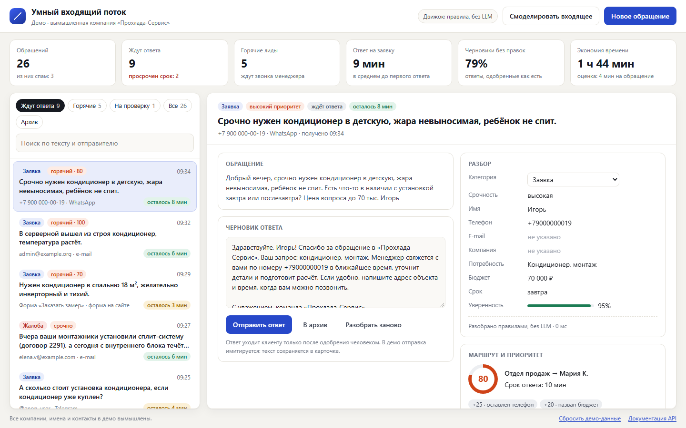
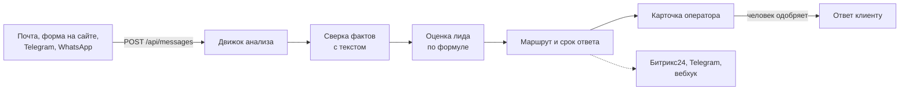

# Умный входящий поток

ИИ-разбор обращений клиентов: письмо, заявка с сайта или сообщение в мессенджере за секунды
превращается в карточку с категорией, контактами, оценкой лида, ответственным сотрудником,
сроком ответа и готовым черновиком ответа.

> Демо-проект. Компания «Прохлада-Сервис», все имена, телефоны и письма вымышлены.



## Какую задачу решает

В небольшой компании входящие разбирает тот, кто свободен. Заявки лежат вперемешку со спамом
и письмами поставщиков, горячий клиент ждёт ответа час, а жалоба доходит до руководителя на
третий день. Система снимает рутину первичной обработки:

| Было | Стало |
|---|---|
| Менеджер читает каждое письмо и решает, кому его передать | Категория, срочность и ответственный определяются автоматически |
| Контакты и детали переносят в CRM руками | Имя, телефон, бюджет и срок извлекаются из текста |
| Горячие и «холодные» заявки стоят в одной очереди | Оценка лида 0–100 и отдельный срок ответа для горячих |
| Ответ пишется с нуля | Оператор правит готовый черновик и нажимает «Отправить» |
| Спам отнимает время | Спам уходит в архив сам |

## Как это работает



1. **Движок анализа** возвращает факты строго по схеме: категория, срочность, суть, контакты,
   потребность, бюджет, срок, черновик ответа, уверенность. Движков два, и они взаимозаменяемы:
   - `claude` — Claude через structured outputs (ответ гарантированно соответствует схеме);
   - `rules` — ключевые слова и регулярные выражения. Работает без интернета и ключей,
     служит базовым уровнем для сравнения и резервом на случай недоступности API.
2. **Сверка фактов.** Телефон и e-mail из ответа модели проверяются по тексту обращения.
   Контакт, которого в письме нет, удаляется: оператор не позвонит по выдуманному номеру.
3. **Оценка лида** считается кодом по открытой формуле (`app/scoring.py`), а не моделью:
   в карточке видно, за что начислен каждый балл.
4. **Маршрут** берётся из таблицы в `data/company.json`: очередь, ответственный, срок ответа.
5. **Человек в контуре.** Ответ клиенту уходит только после одобрения оператором.
   Обращения с низкой уверенностью помечаются «на проверку», правки оператора пишутся в журнал.

## Что можно показать на демо

- входящие с метками категории, приоритета и обратным отсчётом срока ответа;
- карточку обращения: разбор, оценка лида с объяснением, маршрут, черновик ответа, журнал действий;
- кнопку «Смоделировать входящее»: новое обращение разбирается на глазах;
- форму «Новое обращение»: можно вставить собственный текст клиента;
- исправление категории оператором с пересчётом маршрута;
- показатели: сколько ждут ответа, просроченные сроки, доля черновиков без правок, оценка экономии времени.

## Быстрый старт

Нужен Python 3.10+.

```bash
pip install -r requirements.txt
python run.py
```

Откройте http://127.0.0.1:8101. Без ключа API демо работает на движке правил.

Чтобы обращения разбирал Claude, скопируйте `.env.example` в `.env`, впишите `ANTHROPIC_API_KEY`
и перезапустите. В шапке интерфейса появится название модели.

| Команда | Что делает |
|---|---|
| `python run.py --reset` | пересоздаёт демо-данные со свежими датами |
| `python -m pytest` | запускает тесты |
| `python scripts/evaluate.py` | измеряет качество движка правил |
| `python scripts/evaluate.py --engine claude` | измеряет качество Claude (42 платных запроса) |

## Измеренное качество

Наборы размечены вручную. `dev` — 26 обращений, на которых настраивались правила.
`holdout` — 16 обращений, написанных отдельно и не участвовавших в настройке.

Движок правил (`python scripts/evaluate.py`):

| Поле | dev (26) | holdout (16) |
|---|---|---|
| Категория | 100% | 56% |
| Срочность | 96% | 69% |
| Имя | 100% | 100% |
| Телефон | 100% | 100% |
| E-mail | 100% | 100% |
| Компания | 100% | 100% |
| Бюджет | 100% | 94% |

Вывод: регулярные выражения надёжно достают контакты, но понимание смысла на новых
формулировках падает почти вдвое. Жалобу без слова «претензия» правила принимают за заявку.
Именно эту часть берёт на себя LLM.

Качество Claude в этом репозитории не зафиксировано: его нужно измерить на своём ключе командой
выше. Тот же скрипт покажет среднее время ответа и стоимость прогона.

## Интеграции

Включаются переменными окружения, по умолчанию выключены.

| Система | Переменная | Когда срабатывает |
|---|---|---|
| Любой вебхук (n8n, Make, свой сервис) | `OUTGOING_WEBHOOK_URL` | каждое обращение, карточка в JSON |
| Битрикс24 | `BITRIX24_WEBHOOK_URL` | заявки: создаётся лид через `crm.lead.add` |
| Telegram | `TELEGRAM_BOT_TOKEN`, `TELEGRAM_CHAT_ID` | горячие лиды и срочные жалобы |

Приём обращений — один HTTP-метод `POST /api/messages` (описание в `/api/docs`). К нему
подключается форма сайта, почтовый парсер или бот.

Интеграции покрыты тестами на подменённом HTTP-транспорте. На реальном портале Битрикс24
и с реальным ботом Telegram в рамках демо они не запускались.

## Настройка под компанию

| Что меняется | Где |
|---|---|
| Название, профиль, подпись, очереди, ответственные, сроки ответа | `data/company.json` |
| Описания категорий и правила для модели | `app/engines/claude.py`, функция `build_system_prompt` |
| Веса оценки лида | `app/scoring.py` |
| Ключевые слова базового движка | `app/engines/rules.py` |
| Размеченные примеры для проверки качества | `data/messages_*.json` |

## Устройство проекта

```
app/
  engines/claude.py   запрос к Claude, обработка ошибок, расчёт стоимости
  engines/rules.py    базовый движок без LLM
  pipeline.py         движок → сверка → оценка → маршрут, резервный сценарий
  scoring.py          формула оценки лида
  routing.py          очередь, приоритет, срок ответа
  service.py          сценарии: приём, ответ, правка категории, статистика
  integrations.py     вебхук, Битрикс24, Telegram
  db.py               SQLite: карточки и журнал событий
  main.py             HTTP API
  static/             интерфейс оператора (без сборки и фреймворков)
data/                 профиль компании и размеченные обращения
scripts/evaluate.py   оценка качества
tests/                58 тестов
```

## Стоимость и надёжность

- По умолчанию используется `claude-opus-5-5` с `effort=low`. Модель задаётся переменной
  `CLAUDE_MODEL`; для больших потоков стоит сравнить на своём наборе более дешёвые
  `claude-sonnet-5-5` и `claude-haiku-5-5` тем же скриптом оценки.
- Системный промпт помечен для кэширования, поэтому повторные запросы дешевле.
- Для моделей, которые это поддерживают, включён серверный fallback: если классификатор
  безопасности отклонит запрос, API повторит его на запасной модели в том же вызове.
- Если API недоступно, обращение разбирают правила, а в карточке остаётся пометка.
- Стоимость каждого запроса считается по `usage` и видна в карточке. Цены в коде справочные,
  их нужно сверять с актуальным прайсом.

## Ограничения демо

- Отправка ответа клиенту имитируется: текст сохраняется в карточке. Для боевого режима
  подключается SMTP или API мессенджера.
- Нет авторизации и разделения ролей.
- Вложения (фото, PDF) не разбираются.
- Интеграции выполняются фоновой задачей в процессе приложения; под нагрузку нужна очередь.
- Данные обращений уходят во внешнее API. Для персональных данных клиентов это нужно
  согласовать с политикой компании и требованиями 152-ФЗ.
